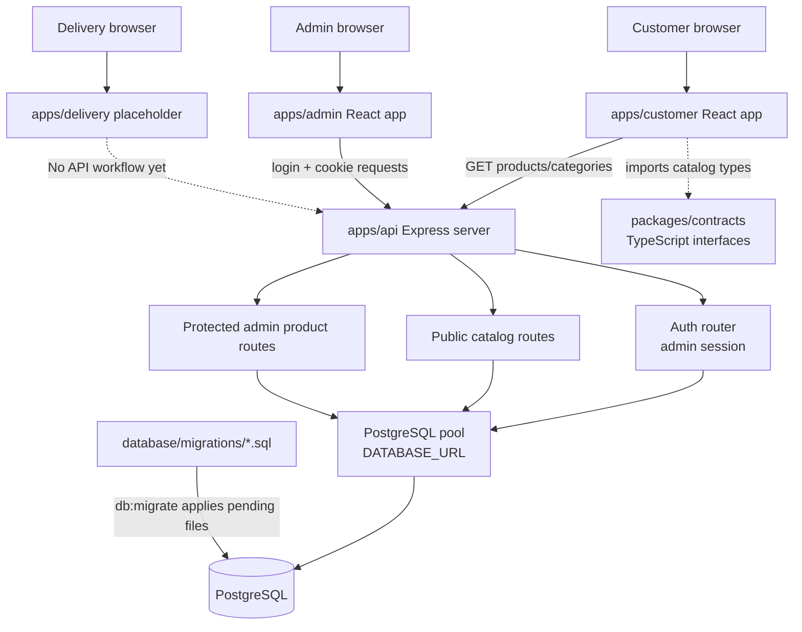

# Chapter 1: Project map and local setup

## What you will learn

After this chapter, you should be able to:

- Explain why FreshMart has multiple apps in one repository.
- Find the source entry point for each app.
- Describe what the API, contracts package, and SQL migrations are for.
- Start the existing development services without overwriting local configuration.
- Distinguish application source from generated files and agent instructions.

## 1. Repository map

```text
F:\grocery-shop\
├── .github\agents\             Copilot agent roles and workflow guidance
├── apps\
│   ├── customer\               Customer storefront (React + Vite)
│   ├── admin\                  Admin sign-in and product management (React + Vite)
│   ├── delivery\               Delivery UI placeholder (React + Vite)
│   └── api\                    Express + TypeScript backend and database tools
├── packages\
│   └── contracts\              Shared TypeScript data interfaces
├── database\
│   └── migrations\             Versioned PostgreSQL schema changes
├── docs\                       Student learning guide
├── package.json                npm workspaces and root commands
├── package-lock.json           Locked npm dependency versions
└── .gitignore                  Excludes dependencies, builds, and environment files
```

### Why one repository contains several apps

The storefront, admin tool, delivery tool, and API are distinct programs. Keeping them in one repository makes it easier to develop and build the related apps together. npm workspaces connect their package manifests; they do not mean the apps run as one process. In development, each app/API still runs as its own server on its own port.

## 2. Application map and important files

### Root files

| File | Purpose and why it exists | Dependencies and effect of changing it |
|---|---|---|
| [`package.json`](../package.json) | Declares workspaces, Node minimum, and commands such as `npm run dev` and `npm run build`. | npm uses it to find the packages and scripts. Changing workspace globs or scripts can affect every app. |
| [`package-lock.json`](../package-lock.json) | Records dependency resolution for repeatable npm installs. | Updated by npm when dependency manifests change; do not hand-edit it. |
| [`.gitignore`](../.gitignore) | Prevents `node_modules`, `dist`, Vite cache, and `.env` files from being tracked. | Changing it can accidentally expose private configuration or include generated output in Git. |

### Customer, admin, and delivery apps

Each app has `index.html`, `src/main.tsx`, `src/App.tsx`, `src/styles.css`, `package.json`, `tsconfig.json`, and `vite.config.ts`.

| File/pattern | Purpose | Connections and practical impact |
|---|---|---|
| `apps/<app>/index.html` | Browser document shell. | Vite loads this page and its module entry point. Document language and metadata belong here or are updated by app code. |
| `apps/<app>/src/main.tsx` | React bootstrap: finds the page root and renders `App`. | If it does not mount the React component, the page remains empty. |
| `apps/<app>/src/App.tsx` | Main screen and app-level state/API interactions. | Customer calls catalog endpoints; admin calls auth and admin-product endpoints; delivery currently contains placeholder content. |
| `apps/<app>/src/styles.css` | App-specific layout, typography, and responsive styling. | Changes affect presentation, not database access or server authorization. |
| `apps/<app>/vite.config.ts` | Configures Vite plugins and development/build behavior. | Each app is served and built independently. |
| `apps/<app>/tsconfig.json` | TypeScript checking options for that app. | Type changes can surface errors during that package's build. |

Current development URLs, taken from each package script:

| Program | URL |
|---|---|
| API | `http://localhost:4000` |
| Customer | `http://localhost:5173` |
| Admin | `http://localhost:5174` |
| Delivery | `http://localhost:5175` |

The presence of the delivery app does not mean delivery workflows are implemented. The current delivery screen is a static starting point.

### API source

| File | Purpose and why it exists | Dependencies and effect of changing it |
|---|---|---|
| [`apps/api/src/index.ts`](../apps/api/src/index.ts) | Creates the Express app, configures CORS/cookies/JSON parsing, mounts routes, exposes health and public catalog endpoints, and starts the server. | Imports the PostgreSQL pool, auth/product routers, and locale resolver. Route or middleware changes can affect all clients. |
| [`apps/api/src/db/pool.ts`](../apps/api/src/db/pool.ts) | Builds the PostgreSQL connection pool from `DATABASE_URL`. | API handlers and CLI utilities query through this pool. It is the server-side database boundary; browser apps must not import it. |
| [`apps/api/src/modules/auth/auth.routes.ts`](../apps/api/src/modules/auth/auth.routes.ts) | Implements administrator login, session introspection/logout, and the `requireAdmin` guard. | Uses the pool and cookie/session logic. Changing this can affect admin sign-in and access to protected routes. |
| [`apps/api/src/modules/products/admin.routes.ts`](../apps/api/src/modules/products/admin.routes.ts) | Implements protected admin product listing/create/update/deactivation and writes translations. | Uses the pool and `requireAdmin`; its response/input shape should stay aligned with the admin UI and contracts. |
| [`apps/api/src/modules/locale.ts`](../apps/api/src/modules/locale.ts) | Resolves supported catalog language codes `en` and `prs` from the request. | Public API routes use its result to select translation rows. |
| [`apps/api/src/modules/locale.test.ts`](../apps/api/src/modules/locale.test.ts) | Tests locale resolution rules. | Run with the API workspace test script. |
| [`apps/api/src/db/migrate.ts`](../apps/api/src/db/migrate.ts) | Applies versioned SQL migrations with a transaction, advisory lock, and checksum record. | Reads `database/migrations`; running it changes database state by applying pending migrations. |
| [`apps/api/src/db/create-admin.ts`](../apps/api/src/db/create-admin.ts) | Interactive CLI for creating an admin account with a password hash. | Writes a new user record. It does not display or recover an existing password. |
| [`apps/api/src/db/create-database.ts`](../apps/api/src/db/create-database.ts) | Database provisioning utility. | Can change database/server state; inspect before running. |

### Shared contracts and database

| Location | Purpose | How changing it affects the project |
|---|---|---|
| [`packages/contracts/src/index.ts`](../packages/contracts/src/index.ts) | Shared TypeScript interfaces for catalog entities and translations. | Customer imports these types. Types help detect mismatches at build time but do not validate JSON at runtime. |
| [`database/migrations/001_initial_schema.sql`](../database/migrations/001_initial_schema.sql) | Creates users, catalog, inventory, order, and delivery tables with constraints and relationships. | It is historical migration input; do not edit after application because the migration runner checks its checksum. |
| [`database/migrations/002_admin_sessions.sql`](../database/migrations/002_admin_sessions.sql) | Adds the administrator session table. | Depends on the `users` table from migration 001. |
| [`database/migrations/003_multilingual_catalog.sql`](../database/migrations/003_multilingual_catalog.sql) | Adds product/category translations and backfills existing English text. | Adds schema/data to the database when applied. The locale constraint permits `en` and `prs`. |

## 3. How the main connections fit



The arrows represent runtime or type relationships:

- A browser fetch is a runtime HTTP request.
- The API executes SQL through the pool; the database does not connect back to the browser.
- Contracts are compile-time TypeScript declarations. Importing an interface does not send code or validate a network response.
- SQL migration files are applied by the migration CLI, not automatically when the API starts.

## 4. Local setup without overwriting configuration

### Requirements

- Node.js 20 or newer (`engines.node` in the root manifest).
- npm.
- A running PostgreSQL instance and a database connection configured for the API.

### Protect the existing environment files

The repository ignores `.env` files. Never paste passwords into source code, documentation, or chat. If `apps/api/.env` or `apps/customer/.env` already exists, preserve it. Do not copy an example over an existing file.

Expected configuration names are documented in:

- [`apps/api/.env.example`](../apps/api/.env.example): `API_PORT`, `DATABASE_URL`, and frontend origins.
- [`apps/customer/.env.example`](../apps/customer/.env.example): `VITE_API_URL`.

The API reads `DATABASE_URL` on the server. Vite variables prefixed with `VITE_` are intended for browser-visible configuration, so they must never contain database credentials.

### Install and run

From `F:\grocery-shop`:

```powershell
npm install
npm run dev
```

`npm run dev` starts the API and all three Vite apps concurrently. To run one process separately, use:

```powershell
npm run dev:api
npm run dev:customer
npm run dev:admin
npm run dev:delivery
```

The API verifies its PostgreSQL connection before it begins listening. If the API fails at startup, check that PostgreSQL is running and that the private `DATABASE_URL` is valid; do not print the URL when troubleshooting.

### Safe checks

```powershell
npm run build
npm test --workspace @grocery-shop/api
```

These commands build the workspaces and run API locale tests. They do not apply migrations.

The following commands have database side effects and are **not** ordinary startup commands:

```powershell
npm run db:create --workspace @grocery-shop/api
~npm run db:migrate --workspace @grocery-shop/api
npm run admin:create --workspace @grocery-shop/api
```

Use them only when you understand the target and effect. In particular, `db:migrate` applies pending schema changes and `admin:create` inserts a user.

## 5. A practical example: locating the catalog path

To follow a customer product list from code to data:

1. Start at [`apps/customer/src/main.tsx`](../apps/customer/src/main.tsx): React mounts the app.
2. Find the fetch in [`apps/customer/src/App.tsx`](../apps/customer/src/App.tsx): it requests `/api/products` and `/api/categories`.
3. Find the matching route in [`apps/api/src/index.ts`](../apps/api/src/index.ts): Express reads query values and runs SQL.
4. Follow the pool import to [`apps/api/src/db/pool.ts`](../apps/api/src/db/pool.ts): SQL is sent to PostgreSQL using the private `DATABASE_URL`.
5. Compare the selected fields with [`packages/contracts/src/index.ts`](../packages/contracts/src/index.ts): the interface describes the expected product response.
6. Compare tables and columns with the migrations under [`database/migrations/`](../database/migrations).

This path is useful when a product fails to appear: the cause could be in the browser request, API filtering, SQL/data, or response rendering. Follow the request in that order rather than changing unrelated layers.

## Key ideas to remember

- **Monorepo:** one repository containing multiple related packages/apps.
- **Frontend:** code running in the browser; it requests data but should not connect directly to PostgreSQL.
- **Backend/API:** server-side code that handles HTTP requests and applies authorization before database operations.
- **Contract:** a shared type-level agreement about data shape; it is not runtime validation.
- **Migration:** a versioned database change that should be applied intentionally and tracked.
- **Generated output:** `dist/` and Vite caches are build artifacts, not the source of truth.

## Check your understanding

1. Why does the customer browser call the API instead of connecting directly to PostgreSQL?
2. Which file configures the API's database pool, and which environment variable does it read?
3. What is the difference between `packages/contracts` and `database/migrations`?
4. Does the existence of `apps/delivery` mean delivery assignments work end-to-end? Why or why not?
5. Which command builds the project without applying migrations?

When you are ready, answer these questions or ask about any section. We will pause here before Chapter 2.
