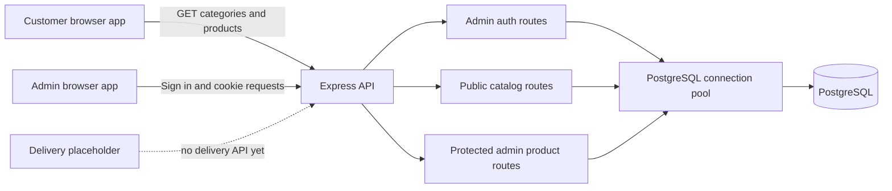

# Chapter 2: System architecture and app boundaries

## What you will learn

After this chapter, you should be able to:

- Explain how the FreshMart programs are separated and how they communicate.
- Distinguish a runtime dependency from a TypeScript-only dependency.
- Describe the responsibility of each workspace.
- Explain why the browser must not connect directly to PostgreSQL.

## 1. One repository, several programs

FreshMart is organized as an npm-workspaces monorepo. The root [`package.json`](../package.json) includes the `apps/*` and `packages/*` directories as workspaces. This lets one install and build command manage related packages together, but it does not combine them into one application process.

The programs have separate responsibilities:

| Workspace             | Responsibility                                                                     | Current status                                            |
| --------------------- | ---------------------------------------------------------------------------------- | --------------------------------------------------------- |
| `apps/customer`       | Public catalog UI: language selection, category filtering, search, product display | Implemented catalog experience                            |
| `apps/admin`          | Administrator sign-in and product catalog management                               | Implemented for product records                           |
| `apps/delivery`       | Delivery staff UI                                                                  | Placeholder screen; no API-backed workflow                |
| `apps/api`            | HTTP API, authorization, SQL queries, database connection, migration/admin CLIs    | Public catalog and admin auth/product routes implemented  |
| `packages/contracts`  | Shared TypeScript data interfaces                                                  | Compile-time types only                                   |
| `database/migrations` | Ordered PostgreSQL schema changes                                                  | Migrations 001–003 describe the current schema foundation |

In development the customer, admin, and delivery apps run as Vite servers, while the API runs as a Node/Express server. Each has a separate local URL. Browser code communicates with the API over HTTP rather than importing server modules.

## 2. Runtime architecture

The flow has two important trust boundaries:

1. The browser sends an HTTP request to the API. It does not get database credentials or permission to issue SQL.
2. The API validates the request, checks authorization where needed, and uses the server-side pool to query PostgreSQL.

This boundary keeps database credentials off the client and centralizes data validation and access rules. A hidden button in a browser is not authorization; protected operations must be guarded by the API.

## 3. Compile-time contracts are not network validation

The customer app imports `Product` and `ProductCategory` from [`packages/contracts/src/index.ts`](../packages/contracts/src/index.ts). These interfaces describe fields such as `id`, `name`, `price`, and translations to TypeScript. The import helps the compiler check code using those values.

The interfaces are not transmitted to the API, and TypeScript types do not inspect JSON at runtime. For example, writing `const data: Product[] = await response.json()` tells the compiler how the code intends to use the result. It does not prove that the server actually sent every field or the right type. Runtime validation is a separate concern that should be added at an API boundary if the application requires it.

The admin app currently declares its own product shape locally in [`apps/admin/src/App.tsx`](../apps/admin/src/App.tsx) rather than consuming the shared `Product` interface. Keep this difference in mind when changing response fields: the API response, admin UI type, customer contract, and consuming code may all need coordinated updates.

## 4. Configuration and service startup

The API reads `DATABASE_URL`, `API_PORT`, and allowed frontend origins from server environment configuration. [`apps/api/src/db/pool.ts`](../apps/api/src/db/pool.ts) creates a PostgreSQL connection pool; the browser apps use `VITE_API_URL` to locate the API. A `VITE_` variable is exposed to browser code after a frontend build, so it must never contain a database password or other server secret.

At startup, the API in [`apps/api/src/index.ts`](../apps/api/src/index.ts) attempts `SELECT 1` before listening. This is a startup connectivity check, not a database migration. The API also exposes:

- `GET /health`: the process is responding.
- `GET /health/ready`: the API can currently query PostgreSQL.

The migration CLI is a separate command. Starting the API does not automatically apply pending migrations.

## 5. Current functional boundary

The implemented end-to-end user paths are the public product catalog and administrator sign-in/product management. The initial database schema also contains users, inventory movements, orders, order items, and deliveries. A table is only a data model: it does not create an API endpoint, UI screen, authorization policy, or tested workflow by itself.

For example, the current delivery screen in [`apps/delivery/src/App.tsx`](../apps/delivery/src/App.tsx) explicitly describes a future queue and status workflow. Do not describe order placement, delivery assignment, or customer accounts as finished features unless the corresponding API and UI behavior has been implemented and verified.

## Key ideas to remember

- npm workspaces group packages for dependency management; they do not erase process boundaries.
- Frontend-to-API communication is HTTP at runtime.
- Shared TypeScript interfaces are compile-time assistance, not runtime validation.
- The API is the server-side boundary between browsers and PostgreSQL.
- Database tables can exist before their application workflows exist.

## Check your understanding

1. Which programs run in the browser, and which one owns the PostgreSQL connection?
2. What does importing a shared interface guarantee, and what does it not guarantee?
3. Why is `VITE_DATABASE_URL` unsafe as an idea for a frontend configuration variable?
4. Does the presence of `orders` and `deliveries` tables mean checkout and delivery are implemented?
5. How are `/health` and `/health/ready` different?

Continue with [Chapter 3: Request and response lifecycles](./03-request-response-lifecycles.md).
