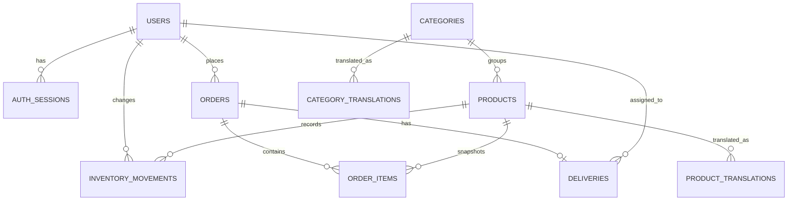

# Chapter 4: PostgreSQL schema and migrations

## What you will learn

After this chapter, you should be able to read the main relationships in the schema, explain what constraints protect, and describe how the migration runner applies changes safely.

## 1. Schema overview

The ordered SQL files are under [`database/migrations`](../database/migrations). They are the versioned source of schema changes. The initial migration creates more tables than the application currently uses; the existence of a table alone does not mean an API workflow exists.



The diagram shows structural relationships, not implemented screens or API endpoints.

## 2. Main tables and their purpose

| Table                   | Purpose and notable rules                                                                                                                                                                               |
| ----------------------- | ------------------------------------------------------------------------------------------------------------------------------------------------------------------------------------------------------- |
| `users`                 | Account identity, password hash, display name, and a role constrained to `customer`, `admin`, or `delivery`. A case-insensitive unique index prevents duplicate emails that differ only by letter case. |
| `auth_sessions`         | Stores the SHA-256 token hash, user reference, expiry, and creation time for administrator sessions.                                                                                                    |
| `categories`            | Base category name and unique slug.                                                                                                                                                                     |
| `products`              | SKU, base name/description, unit, USD price, stock quantity, optional image/category, and active flag. Numeric values have non-negative checks; SKU is unique.                                          |
| `product_translations`  | Product name and description per locale. The pair `(product_id, locale)` is the primary key.                                                                                                            |
| `category_translations` | Category name per locale, with `(category_id, locale)` as the primary key.                                                                                                                              |
| `inventory_movements`   | Signed quantity changes, reason, product, optional changing user, and timestamp. The table exists, but the current product editing API changes stock directly and does not write movement rows.         |
| `orders`                | Customer reference, delivery contact/address snapshot, status, subtotal, fee, total, and timestamps. A check enforces `total = subtotal + delivery_fee`.                                                |
| `order_items`           | Product reference when available, plus product name/unit/price snapshots and quantity. `line_total` is generated by PostgreSQL.                                                                         |
| `deliveries`            | One delivery per order, optional assignee, status, timestamps, and failure note. A check ties the `unassigned` state to a null assignee.                                                                |

Important delete rules are deliberate: for example, an order item can retain its historical product name and price if the product is removed (`product_id` can become null), while the order itself cannot be deleted while a delivery references it.

## 3. Constraints and indexes

Constraints protect data no matter which client writes it. Examples include:

- `NOT NULL` on required names, roles, prices, and foreign keys.
- `CHECK` rules for allowed roles/status values, nonnegative money and stock, positive order quantities, and the total calculation.
- `UNIQUE` rules for SKUs, category slugs, session token hashes, and order-to-delivery association.
- Foreign keys that define what happens when a referenced row is deleted.

Indexes support common lookups and ordering: active product names, product category IDs, customer order history, order status, product movement history, delivery assignment/status, and translation locale/name. Indexes improve reads but consume space and add work to writes, so they should match observed query patterns rather than being added by habit.

PostgreSQL `NUMERIC(precision, scale)` precision counts all digits, including fractional digits; scale counts the fractional digits. Therefore `NUMERIC(12,3)` stock allows 9 integer digits and a maximum nonnegative value of `999999999.999`. Price uses `NUMERIC(12,2)`, so its maximum is `9999999999.99`. The admin minimum, maximum, and step now match the stock column, and API validation derives integer digits as precision minus scale. This validation update changed no schema and applied no migration. The API serializes numeric fields as text; client code should not assume they are JavaScript integers.

## 4. What migration 003 does

[`003_multilingual_catalog.sql`](../database/migrations/003_multilingual_catalog.sql) creates product and category translation tables for `en` and `prs` (Dari), with indexes on locale/name. It copies each existing base product and category value into an English translation unless that translation already exists. The product description backfill uses `COALESCE(description, '')`, so a legacy null description becomes an empty translation description. It then checks that each existing product and category has an English translation and raises an exception if the backfill is incomplete.

The migration is designed to preserve existing English catalog content while enabling localized values. The public catalog query uses a translation when one exists and falls back to the base product/category columns when it does not.

## 5. How the migration runner works

Run-time migration behavior is implemented in [`apps/api/src/db/migrate.ts`](../apps/api/src/db/migrate.ts):

1. It reads `.sql` filenames from the migrations directory, sorts them, and checks that each filename follows a three-digit version naming pattern.
2. It computes a SHA-256 checksum for each file.
3. For each file, it opens a PostgreSQL transaction and obtains a transaction-scoped advisory lock so concurrent migration processes do not apply the same changes at once.
4. It creates `schema_migrations` if needed and checks whether the filename has already been recorded.
5. If already recorded with a different checksum, it stops rather than silently accepting a modified historical migration.
6. If pending, it runs the SQL, inserts the filename/checksum into `schema_migrations`, and commits.
7. If any step throws, it rolls back that file's transaction and exits with an error.

The migration record and its schema changes are committed together. Thus a failed SQL migration does not leave a success record or a committed partial migration, provided every operation in the migration is transaction-compatible. Migrations 001–003 use transactional PostgreSQL statements.

## 6. Safe migration workflow

Migration commands change the target database. Before applying one:

1. Confirm which database the private `DATABASE_URL` targets without publishing the credential.
2. Inspect the migration SQL and its dependencies on existing tables/data.
3. Take a database backup using locally installed PostgreSQL tools and choose an output path outside source control.
4. Confirm the current migration ledger and expected pending version.
5. Apply only the reviewed migration, then verify the schema and application behavior.

Do not edit an already-applied migration to make a new change. Add a new numbered migration instead. The checksum guard intentionally makes changes to an applied file visible.

The project command is:

```powershell
npm run db:migrate --workspace @grocery-shop/api
```

Do not run it as a build or startup step. A build checks code; a migration changes a database.

## Key ideas to remember

- Relational constraints encode invariants in the database itself.
- Foreign keys define relationships and deletion behavior.
- `NUMERIC` is appropriate for exact decimal values such as prices.
- A migration is a versioned database change, not just a SQL snippet.
- The runner checks order, concurrency, checksums, and transactional success recording.
- Tables for future workflows must not be presented as complete product features.

## Check your understanding

1. Why does `order_items` retain product name and unit price rather than relying only on a live product join?
2. What is the difference between a primary key and a foreign key in the translation tables?
3. What safety purpose does the migration checksum provide?
4. Why should a new change be a new migration instead of editing an applied file?
5. Which schema tables exist for planned workflows that the current UI/API does not yet implement?

Continue with [Chapter 5: Authentication, roles, and localization](./05-authentication-roles-localization.md).
