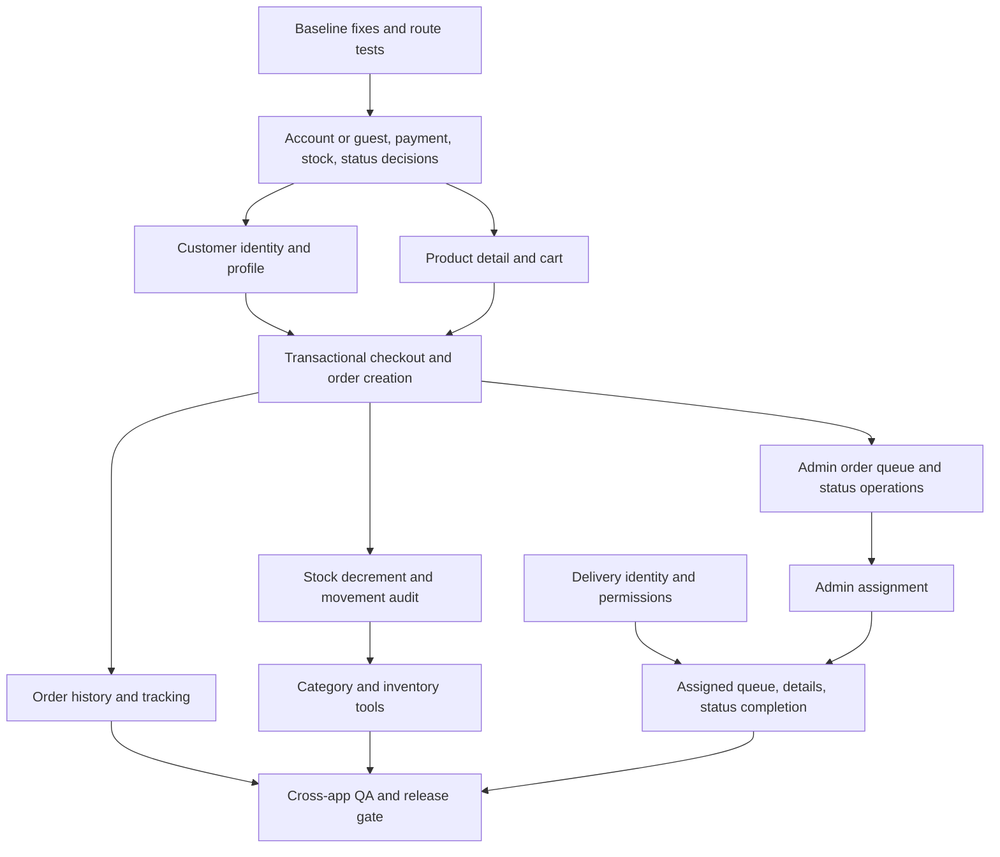

# Chapter 8: MVP roadmap and student learning plan

## What you will learn

After this chapter, you should be able to:

- Separate working capabilities from partial features and schema-only foundations.
- Prioritize a grocery MVP around a complete, safe purchase and fulfillment path.
- Explain which layers and files a feature crosses and what it depends on.
- Choose the next task and specialist agent without starting an oversized rewrite.
- Follow a learning process before, during, and after implementation.

This roadmap is based on the source, migrations, current database metadata, and safe read-only checks. It is a planning document, not approval to implement any item.

## 1. Verified starting point

The working baseline is a public catalog with product search/category filtering, English/Dari locale switching and fallback, administrator authentication, and admin product CRUD. The current responsive views fit the tested mobile widths. All workspaces built successfully, and the existing four locale tests passed during the audit.

The PostgreSQL schema includes customer/admin/delivery roles, sessions, products, categories, translations, inventory movements, orders, order items, and deliveries. The order and delivery tables are foundations only: the API has no customer, order, or delivery routes, and the corresponding API module folders are empty. The delivery app is static. No customer accounts, cart, checkout, or order history exist.

Several capabilities work but need better coverage before expansion: admin login and product writes were not exercised with real credentials or writes; route-level tests are absent; the live catalog has incomplete Dari translation coverage. Malformed JSON on admin login still returns `500` instead of `400`. Stock precision validation is now aligned with `NUMERIC(12,3)` and has focused API boundary tests; no schema change or migration was made.

## 2. Priority definitions

| Priority            | Meaning                                                                                                                                                                              |
| ------------------- | ------------------------------------------------------------------------------------------------------------------------------------------------------------------------------------ |
| **MVP Critical**    | Required for a customer to place an order safely and for the store to receive and process it. Release-blocking.                                                                      |
| **High Priority**   | Needed for normal operation, fulfillment, access control, or reliable management, but can follow the minimum purchase path if an interim operating procedure is explicitly accepted. |
| **Medium Priority** | Improves efficiency, usability, content coverage, or scale after the core operational path works.                                                                                    |
| **Future Features** | Optional capabilities or provider/deployment decisions not required to validate the local MVP.                                                                                       |

Status labels distinguish **Working**, **Partial**, **Missing**, and **Schema only**. Features listed as working remain in the plan for regression tests, not reimplementation.

## 3. Consolidated feature inventory

Duplicate audit items are combined by capability. For example, “order placement” is listed once as a customer/backend/database workflow rather than repeated under every layer; layer involvement is included in its row.

### Customer experience

| Feature                                   | Priority and current status                                                                                             | Dependencies, target work, and likely files                                                                                                                                                                                                                                                                                                    | Responsible agent                                                              |
| ----------------------------------------- | ----------------------------------------------------------------------------------------------------------------------- | ---------------------------------------------------------------------------------------------------------------------------------------------------------------------------------------------------------------------------------------------------------------------------------------------------------------------------------------------- | ------------------------------------------------------------------------------ |
| Homepage/store entry                      | MVP Critical — **Working baseline**; the catalog is the first page, not a separate home route.                          | Preserve the catalog entry point. Add navigation only when additional customer pages exist. `apps/customer/src/App.tsx`, `apps/customer/src/styles.css`                                                                                                                                                                                        | Frontend Customer; UI/UX Design Director for new navigation                    |
| Product catalog                           | MVP Critical — **Working**; live API responses and cards verified.                                                      | Keep current API/contract/UI mapping stable. `apps/customer/src/App.tsx`, `apps/api/src/index.ts`, `packages/contracts/src/index.ts`                                                                                                                                                                                                           | Frontend Customer; Backend API                                                 |
| Product search                            | MVP Critical — **Working with a locale limitation**.                                                                    | Decide whether to search selected-locale text, both locales, or normalized catalog text; then test that rule. `apps/customer/src/App.tsx`, `apps/api/src/index.ts`, API tests                                                                                                                                                                  | Backend API; Frontend Customer; QA Reviewer                                    |
| Category filtering                        | MVP Critical — **Working**; live category filter returned products.                                                     | Preserve slug as the stable filter value while localizing the label. `apps/customer/src/App.tsx`, `apps/api/src/index.ts`, translations                                                                                                                                                                                                        | Frontend Customer; Backend API                                                 |
| Product details and image display         | MVP Critical — **Missing**; cards show summary text, and `imageUrl` is not rendered.                                    | Depends on existing product response. Add a detail view/navigation and display the existing URL safely; no upload/storage provider is in scope. `apps/customer/src/App.tsx`, `apps/customer/src/styles.css`, `apps/api/src/index.ts`, contracts                                                                                                | UI/UX Design Director, then Frontend Customer; Backend API if contract changes |
| English/Dari switching and content        | MVP Critical — **Partial**; switch and fallback work, but one live product has no Dari translation.                     | Define required translation coverage and fallback acceptance. Keep `en`/`prs` consistent. `apps/customer/src/App.tsx`, `apps/admin/src/App.tsx`, `apps/api/src/modules/locale.ts`, migrations 003, contracts                                                                                                                                   | Frontend Customer, Frontend Admin; QA Reviewer                                 |
| RTL/LTR                                   | MVP Critical — **Partial**; `lang`/`dir` switch works, but full visual and interaction coverage is not yet established. | Test customer and future account/checkout screens in both directions. `apps/customer/src/App.tsx`, `apps/customer/src/styles.css`, new customer screens                                                                                                                                                                                        | UI/UX Design Director; Frontend Customer; QA Reviewer                          |
| Customer registration, login, and profile | MVP Critical — **Missing**. The schema allows `customer`, but auth routes are admin-only.                               | Decide account vs guest checkout first. Current `orders.customer_id` is `NOT NULL`, so account-based checkout fits the existing model; guest checkout needs an explicit data-model decision. Add customer auth, profile and address policy. `apps/api/src/modules/auth/`, new customer module, `apps/customer/src/`, migrations only if needed | Project Architect; Database Architect; Backend API; Frontend Customer          |
| Shopping cart                             | MVP Critical — **Missing**.                                                                                             | Depends on product/price/stock display and UX choice for persistence. Cart values are untrusted; server must re-read prices and stock at checkout. `apps/customer/src/`, contracts; API only if a server cart is chosen                                                                                                                        | UI/UX Design Director; Frontend Customer; Backend API                          |
| Checkout and order placement              | MVP Critical — **Missing; schema only**.                                                                                | Depends on identity/guest decision, cart, delivery/contact fields, payment policy, and stock policy. Server calculates totals from current DB values and writes order/items atomically. `apps/customer/src/`, new `apps/api/src/modules/orders/`, `apps/api/src/index.ts`, contracts, new migration only if required                           | Project Architect; Database Architect; Backend API; Frontend Customer          |
| Order history and tracking                | MVP Critical — **Missing; schema only**.                                                                                | Depends on authenticated customer identity, order creation, and a defined order-status lifecycle. Scope each query to the signed-in customer. `apps/customer/src/`, order API module, contracts                                                                                                                                                | Backend API; Frontend Customer; QA Reviewer                                    |
| Responsive mobile shopping                | MVP Critical — **Working in tested widths; broader flow unverified**.                                                   | Re-test details, cart, forms, errors, and RTL at mobile/tablet sizes as those screens are added. `apps/customer/src/styles.css`, new customer screens                                                                                                                                                                                          | Frontend Customer; QA Reviewer                                                 |

### Admin and store operations

| Feature                             | Priority and current status                                                                                                              | Dependencies, target work, and likely files                                                                                                                                                                                                     | Responsible agent                                                            |
| ----------------------------------- | ---------------------------------------------------------------------------------------------------------------------------------------- | ----------------------------------------------------------------------------------------------------------------------------------------------------------------------------------------------------------------------------------------------- | ---------------------------------------------------------------------------- |
| Admin authentication                | High — **Implemented; partially verified**. Unauthorized guards were checked; valid sign-in/CRUD were not run during the no-write audit. | Add route/session tests and preserve origin, expiry, cookie, and role checks. `apps/api/src/modules/auth/auth.routes.ts`, `apps/admin/src/App.tsx`                                                                                              | Backend API; QA Reviewer                                                     |
| Product create/read/update/remove   | MVP Critical — **Implemented**; UI is connected; removal is a soft delete.                                                               | Regression-test validation, transactions, translations, and removed-product behavior. Do not rebuild existing CRUD without a failing acceptance test. `apps/admin/src/App.tsx`, `apps/api/src/modules/products/admin.routes.ts`                 | Backend API; Frontend Admin; QA Reviewer                                     |
| Category management                 | High — **Partial**; a category can be created/upserted through product save, but no standalone category workflow exists.                 | Depends on category slug/localization rules. Add list/edit/deactivate and duplicate handling if operationally required. Admin UI, admin API module, contracts; migration only if requirements need new data                                     | Frontend Admin; Backend API; Database Architect if schema changes            |
| Inventory adjustment and history    | High — **Partial**; stock is editable on products, but `inventory_movements` is not written.                                             | Stock input bounds now match `NUMERIC(12,3)`. Record adjustments transactionally with actor/reason; order placement must coordinate stock decrement. `apps/admin/src/App.tsx`, product routes or new inventory module, migrations/schema, tests | Database Architect; Backend API; Frontend Admin; QA Reviewer                 |
| Product translations in admin       | High — **Partial**; English/Dari fields persist, but missing Dari content falls back.                                                    | Define completeness rules and add coverage monitoring or validation. Existing admin/product routes and migration 003                                                                                                                            | Frontend Admin; Backend API; QA Reviewer                                     |
| Admin order queue/status management | MVP Critical — **Missing; schema only**.                                                                                                 | Depends on order creation and status-transition rules; required before enabling checkout for real customers. Add authorized list/detail/update routes and UI. New orders module, API mount, admin screens, contracts                            | Project Architect; Backend API; Frontend Admin; Database Architect if needed |
| Delivery assignment                 | High — **Missing; schema only**.                                                                                                         | Depends on order queue and delivery-person identity. Enforce valid role and assignment/status invariants server-side. New delivery module, admin UI, contracts; existing deliveries schema                                                      | Backend API; Frontend Admin; Database Architect                              |
| Customer management                 | Medium — **Missing**.                                                                                                                    | Depends on customer accounts and privacy/permission rules. Add only operationally needed profile/order support. New admin API/UI modules, contracts                                                                                             | Project Architect; Backend API; Frontend Admin                               |
| Dashboard statistics                | Medium — **Missing**.                                                                                                                    | Depends on stable order/inventory definitions and enough real activity; avoid misleading metrics before order workflows exist. Admin API queries and dashboard UI                                                                               | Frontend Admin; Backend API; QA Reviewer                                     |
| Roles and permissions               | High — **Partial**; database roles exist and admin guard protects current admin routes; customer/delivery enforcement is absent.         | Define route/action matrix before adding customer/delivery routes. Enforce on API, not only in UI. Auth modules, new customer/delivery modules, tests                                                                                           | Project Architect; Backend API; QA Reviewer                                  |

### Delivery, backend, and quality

| Feature                                | Priority and current status                                                                                                                        | Dependencies, target work, and likely files                                                                                                                                                                             | Responsible agent                                                 |
| -------------------------------------- | -------------------------------------------------------------------------------------------------------------------------------------------------- | ----------------------------------------------------------------------------------------------------------------------------------------------------------------------------------------------------------------------- | ----------------------------------------------------------------- |
| Delivery staff authentication          | High — **Missing**; no delivery login or session route.                                                                                            | Depends on user provisioning and role policy; share/reuse secure session principles without broadening admin access. Auth routes, delivery UI, schema only if required                                                  | Backend API; Delivery App; Database Architect                     |
| Assigned orders and order details      | High — **Missing; schema only**.                                                                                                                   | Depends on admin assignment and delivery auth; scope every query to the assigned delivery person. New delivery API/UI modules, contracts                                                                                | Backend API; Delivery App; QA Reviewer                            |
| Customer delivery information          | MVP Critical for checkout; delivery display is High — **No workflow**.                                                                             | Collect/validate recipient, phone, address, notes at checkout and expose only to authorized admin/assigned delivery roles. Customer, order, delivery modules/UI, contracts                                              | Backend API; Frontend Customer; Frontend Admin; Delivery App      |
| Delivery status and completion         | High — **Missing; schema only**.                                                                                                                   | Depends on assigned orders and transition rules; update status/timestamps atomically and reject invalid transitions. Delivery API/UI, order/delivery schema as needed                                                   | Backend API; Delivery App; Database Architect; QA Reviewer        |
| API endpoints and integration          | MVP Critical — **Partial**; health/catalog/admin auth/product routes are present; order/customer/delivery routes return `404`.                     | Add contracts and route tests with each vertical slice. `apps/api/src/index.ts`, `apps/api/src/modules/`, contracts                                                                                                     | Backend API; Project Architect; QA Reviewer                       |
| Request validation                     | MVP Critical — **Partial**; product/search validation exists, malformed JSON still returns `500`, and stock bounds now match DB precision.         | Fix parser error mapping before adding checkout validation. API entry, product routes, admin input, route tests                                                                                                         | Backend API; QA Reviewer; Frontend Admin where HTML bounds change |
| Authentication/authorization coverage  | MVP Critical — **Partial** for future customer checkout; admin flow exists.                                                                        | Customer and delivery policies must precede protected flows. Auth routes and new role-specific middleware/routes, tests                                                                                                 | Project Architect; Backend API; QA Reviewer                       |
| Product/category queries and search    | MVP Critical — **Working** for current catalog.                                                                                                    | Keep parameterized queries; add paging/index review only when catalog scale requires it. `apps/api/src/index.ts`, query tests                                                                                           | Backend API; QA Reviewer                                          |
| Localization and fallback              | High — **Mechanism works, data incomplete**.                                                                                                       | Set content-coverage expectations and test missing-translation behavior in both apps. Locale resolver, apps, migration 003, contracts                                                                                   | Frontend Customer; Frontend Admin; QA Reviewer                    |
| Error handling and data integrity      | MVP Critical — **Partial**; DB constraints and product transactions exist, but parser errors misclassify and inventory audit is disconnected.      | Standardize client/server errors; order totals, stock, order rows, and movement records must be transactionally consistent. API entry/routes, schema/migrations, tests                                                  | Backend API; Database Architect; QA Reviewer                      |
| Automated tests and security review    | MVP Critical — **Partial**; current API tests cover locale resolution and decimal boundaries; route-level tests remain absent.                     | Add route validation/auth/catalog/order tests and cross-role access tests; do not use real business records as fixtures. `apps/api/src/**/*.test.ts`, frontend tests if existing conventions permit, all app workspaces | QA Reviewer; Backend API; relevant frontend specialist            |
| Accessibility, responsive, performance | Medium — **Partially checked**; tested current pages had no overflow at audited widths, but no complete interaction/a11y/performance suite exists. | Re-test every new state and both locales; add pagination/debounce only when needed. App styles/screens, QA checks                                                                                                       | UI/UX Design Director; relevant frontend agent; QA Reviewer       |

## 4. Dependency map

### Decisions that must be resolved early

- **Account or guest checkout:** current `orders.customer_id` requires a user. This roadmap recommends account-based checkout for the first implementation because it matches the schema; guest checkout would require a separately reviewed data-model design.
- **Payment:** current schema has no payment status/provider fields or payment integration. Decide whether MVP uses an explicitly documented manual/pay-on-delivery process. Do not add a payment provider without approval.
- **Stock policy:** define whether checkout reserves or decrements stock, how unavailable quantities are handled, and whether cancellation restores stock. Make order and inventory changes transactional.
- **Order state machine:** define allowed transitions and who may trigger them before writing admin or delivery endpoints.
- **Image handling:** the existing product record has an optional URL. Displaying an existing URL does not imply upload/storage has been selected; hosting and storage are deferred.

## 5. Milestones and complexity

Complexity is relative scope, not a calendar promise: **S** one focused file/layer; **M** a few coordinated files; **L** a cross-layer vertical slice; **XL** multiple apps, authorization, schema/data integrity, and integration tests.

| Milestone                                        | Outcome and included work                                                                                                                                                                                                              | Dependencies/layers                                                                                                                                     | Complexity and leads                                                                                                          |
| ------------------------------------------------ | -------------------------------------------------------------------------------------------------------------------------------------------------------------------------------------------------------------------------------------- | ------------------------------------------------------------------------------------------------------------------------------------------------------- | ----------------------------------------------------------------------------------------------------------------------------- |
| **1. Baseline reliability and decisions**        | Completed task: align stock bounds and add focused boundary tests. Malformed-JSON handling, route tests, and policy decisions remain unstarted. Existing catalog/product behavior remains unchanged.                                   | Existing API/admin/database constraints; API and tests, small admin form change; no migration for the completed validation task.                        | **M** — Backend API lead, QA Reviewer; Project Architect for decisions, Frontend Admin for form bound.                        |
| **2. Customer identity and shopping foundation** | Customer registration/login/profile; product detail view; cart interaction and persistence policy; English/Dari and RTL states for new screens.                                                                                        | Identity decision; existing product/catalog API and contracts; customer auth backend plus customer frontend.                                            | **L** — Project Architect, UI/UX Design Director, Backend API, Frontend Customer, Database Architect if schema is approved.   |
| **3. Orders and operational fulfillment**        | Server-authoritative checkout, order/items transaction, stock handling and movement audit, customer history/tracking, admin order list/details/status operations. Do not enable real checkout before admin can receive/process orders. | Milestone 2 identity/cart; order status/payment/stock policies; order/inventory schema review; API, customer/admin UI, contracts, migrations if needed. | **XL** — Database Architect, Backend API, Frontend Customer, Frontend Admin, QA Reviewer.                                     |
| **4. Admin store operations**                    | Standalone category management; auditable manual inventory adjustment; customer support views; dashboard statistics once order data is meaningful; translation coverage workflow.                                                      | Existing admin auth/product CRUD; role matrix; Milestone 3 for meaningful order metrics.                                                                | **L** — Frontend Admin, Backend API, Database Architect, QA Reviewer.                                                         |
| **5. Delivery workflow**                         | Delivery login; assignee-scoped queue/details; authorized customer delivery information; valid pickup/delivered/failure transitions; admin assignment.                                                                                 | Orders and admin status operations (M3); delivery role/authorization; delivery schema review.                                                           | **L** — Delivery App, Backend API, Database Architect, Frontend Admin, QA Reviewer.                                           |
| **6. MVP quality and release gate**              | Route/integration and cross-role tests; mobile/RTL/accessibility review; error-state review; performance checks appropriate to actual catalog size; fix regressions. Quality checks also run in every earlier milestone.               | All MVP flows implemented; test data isolated from real business records.                                                                               | **L** — QA Reviewer lead with every feature specialist; Documentation Agent updates verified chapters.                        |
| **7. Optional improvements**                     | Catalog paging/debounce and scale work; richer statistics; image upload/storage or payment-provider integrations only after product/provider approval.                                                                                 | Stable MVP behavior, observed need, explicit storage/payment decisions.                                                                                 | **M–XL** — Project Architect, UI/UX Design Director, and relevant specialist agents. Hosting/deployment remains out of scope. |

### Release dependency note

Milestones 2 and 3 together form the purchase MVP. Checkout should remain unavailable to real customers until order creation, stock integrity, admin order operations, and a documented fulfillment/payment process have all passed the release checks. Delivery is a required operational milestone if the product promise is home delivery; if pickup/manual delivery is accepted temporarily, record that as an explicit MVP policy rather than implying the delivery app works.

## 6. Agent responsibility

Use the lead specialist for implementation and invoke the supporting specialist when the change crosses their boundary. No agent should silently make product-policy or destructive database decisions.

| Work                                                               | Lead agent            | Supporting agents                                       |
| ------------------------------------------------------------------ | --------------------- | ------------------------------------------------------- |
| Scope, API boundaries, identity/payment/order decisions            | Project Architect     | FreshMart Orchestrator, Database Architect, Backend API |
| User flows, responsive/RTL interaction specification               | UI/UX Design Director | Frontend Customer, Frontend Admin, Delivery App         |
| Schema, migrations, indexes, transactions, integrity               | Database Architect    | Backend API, QA Reviewer                                |
| API routes, validation, authorization, order logic                 | Backend API           | Project Architect, Database Architect, QA Reviewer      |
| Customer account, catalog detail, cart, checkout/history UI        | Frontend Customer     | UI/UX Design Director, Backend API, QA Reviewer         |
| Admin categories, inventory, order operations, customer tools      | Frontend Admin        | UI/UX Design Director, Backend API, Database Architect  |
| Delivery sign-in, queue, details, status UI                        | Delivery App          | Backend API, Database Architect, UI/UX Design Director  |
| Behavior, security, access, accessibility, responsive verification | QA Reviewer           | All specialists who changed the slice                   |
| Learning guide and verified setup/architecture updates             | Documentation Agent   | Owning implementation agent, QA Reviewer                |

The repository’s coordinated process is described in [`.github/agents/WORKFLOW.md`](../.github/agents/WORKFLOW.md). The user’s requested before/during/after learning checkpoints are defined in [Chapter 6](./06-code-and-feature-development.md).

## 7. Completed stock precision task

Stock precision alignment is complete: `NUMERIC(12,3)` permits a maximum nonnegative stock of `999999999.999`, the admin bounds match, and API validation enforces precision-derived integer and fractional digit limits. Focused API tests cover accepted and rejected boundaries; `npm test --workspace @grocery-shop/api` includes these tests. No schema change or migration occurred. The separate malformed-JSON `400` fix, route-level tests, and policy decisions in Milestone 1 remain unstarted.

## 8. Learning and documentation plan

For every task, follow [Chapter 6’s student-paced protocol](./06-code-and-feature-development.md): explain the problem, solution, affected files and connections, rationale, risks, and dependencies before coding; explain important logic and data flow during coding; then report every modified file, behavior, test procedure/results, documentation update, and understanding questions.

Update the guide as each verified milestone changes the system:

| Documentation chapter                                                             | Update when                                                                                         |
| --------------------------------------------------------------------------------- | --------------------------------------------------------------------------------------------------- |
| [Chapter 1: Project map and setup](./01-project-map-and-setup.md)                 | A new app/package, command, port, or setup prerequisite is introduced.                              |
| [Chapter 2: Architecture](./02-system-architecture.md)                            | An app boundary, API module, contract, or runtime connection changes.                               |
| [Chapter 3: Request lifecycles](./03-request-response-lifecycles.md)              | A customer/admin/delivery request or data flow is implemented.                                      |
| [Chapter 4: Database and migrations](./04-database-and-migrations.md)             | A schema/migration or data-integrity rule changes; document only reviewed/applied state accurately. |
| [Chapter 5: Auth, roles, localization](./05-authentication-roles-localization.md) | Login, session, permissions, locale behavior, or translation coverage changes.                      |
| [Chapter 6: Safe feature development](./06-code-and-feature-development.md)       | The learning/checking workflow or implementation conventions change.                                |
| [Chapter 7: Glossary and review](./07-glossary-and-review.md)                     | New concepts or implemented capabilities need presentation/viva coverage.                           |
| This roadmap                                                                      | A milestone is approved, completed, reprioritized, or blocked by a verified decision.               |

## Check your understanding

1. Why does the current `orders.customer_id` column make identity policy a checkout dependency?
2. Which milestone must be complete before real checkout is enabled, and why?
3. Trace stock quantity from the admin input to the PostgreSQL column. Where do the current bounds disagree?
4. Which specialist should lead a migration proposal, and who should test the resulting API behavior?
5. What must Copilot explain before coding, while coding, and after coding?

This roadmap is ready for review. Do not start a feature milestone until its scope and acceptance criteria are approved.
